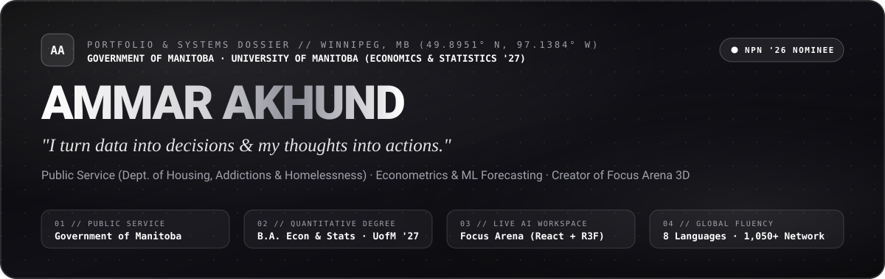
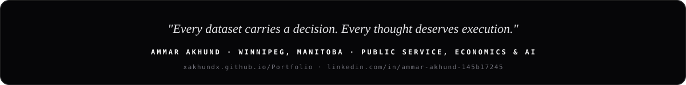

<div align="center">



<br/>

<p align="center">
  <a href="https://xakhundx.github.io/Portfolio/">
    
  </a>
  <a href="https://xakhundx.github.io/Ai-Pomodoro-App/">
    
  </a>
  <a href="https://www.linkedin.com/in/ammar-akhund-145b17245/">
    
  </a>
  <a href="mailto:ammar.akhund2017@gmail.com">
    
  </a>
</p>

</div>

---

### `01 // OVERVIEW`

Personal showcase, interactive portfolio, and systems dossier for **Ammar Akhund**:
- **Public Service:** Administrative Assistant / Office Clerk at the **Government of Manitoba** (*Department of Housing, Addictions & Homelessness*) · Nominated for the **2026 New Professionals Network (NPN) Conference — "A Future-Fit Public Service"**.
- **Academics:** Final-year **Economics (Major) & Statistics (Minor)** undergraduate at the **University of Manitoba (`'27`)**. Active in **UMAI, UMPPC, CSSA, devClub, Hackathon '24 & Game Jam '24**.
- **Industry & Enterprise:** Nearly 4 years of frontline customer experience and SAP ERP reconciliation at **Loblaw Companies Limited (Real Canadian Superstore)**.
- **Simulations & Certifications:** **Forage** (*Bank of America Private Bank Job Simulation* Certified ID `47GYdFA26grz6tmao`, *Goldman Sachs* operational risk, *KPMG* data quality auditing); **Headstarter** Software Engineering / AI Fellow.

---

### `02 // ARCHITECTURE & INSPIRATIONS`

This portfolio rebuild fuses 6 visual & architectural systems:
1. **Interactive WebGL Shader & 3D Constellation:** GPU-accelerated liquid obsidian shader field & 3D node network (`xakhundx/shadergradient` + `xakhundx/react-three-fiber`).
2. **Apple-Inspired Liquid Glass UI:** Specular rim refraction, depth layers, and cursor-tracked spotlights (`xakhundx/liquid-glass-js`).
3. **Liquid-Metal Chrome Aesthetics:** Wave preloader & liquid-chrome typography (`xakhundx/liquid-logo` + Sushmita Dasari's `videoportfolio-kohl.vercel.app`).
4. **Interactive Hero Presentation Deck:** 3D mouse-tilt portrait frame with auto-cycling telemetry deck, Web Speech voice briefing, and autoplay/unmute reel controller.
5. **3D Flipping Periodic Table (30 Elements):** Every periodic-table skill tile flips in 3D on hover/tap with category filters & "Flip All Tiles" mode.
6. **3D Flipping Credential Badges:** Sushmita-style system badges that flip to verify IDs and certifications.

---

### `03 // REPO STRUCTURE`

```text
├── index.html                   # Semantic markup, SVG filters & glass layout
├── css/
│   └── styles.css               # Apple liquid-glass, WebGL canvas, 3D flip styling
├── js/
│   ├── data.js                  # Single editable data store (LinkedIn, projects, skills)
│   └── main.js                  # Preloader, shader canvas, 3D tilt, flip matrix & audio
├── assets/
│   ├── hero-poster.jpg          # LinkedIn studio portrait (242 KB)
│   ├── hero.mp4                 # (Optional) Drop Kling AI / recorded video here
│   ├── hero.vtt                 # WebVTT captions
│   ├── projects/
│   │   └── focus-arena.png      # High-res screenshot of Focus Arena 3D workspace
│   └── github/
│       ├── hero-banner.svg      # Wide SVG hero banner
│       ├── achievement-motif.svg# NPN '26 Government of Manitoba badge
│       ├── tech-constellation.svg# 30-element periodic architecture diagram
│       └── footer-signature.svg # Editorial quote & signature banner
└── github-profile/
    └── README.md                # Ready-to-use profile README for xakhundx/xakhundx
```

---

<details>
<summary><strong>Working Notes & Upcoming Ideas</strong></summary>

- Gmail signin to track active users plus Google Forms for feedback.
- Add transformations for certain power levels; add grouping and dividends.
- AI platform that generates an interactive dashboard for any company to assess financial costs and track progress.
- Diff themes prompt box, no user API key required, Google AI mode conversation.
</details>

<div align="center">
  
</div>
